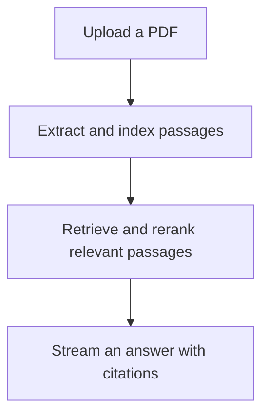

  

  <strong>Frontend Engineer · React, Next.js & TypeScript</strong> 
  Enterprise workflows, real-time applications, and AI-powered interfaces

  <a href="https://uzairansari11.vercel.app/"><strong>View portfolio</strong></a> ·
  <a href="#featured-repositories"><strong>Explore the code</strong></a> ·
  <a href="https://www.linkedin.com/in/uzairansari11/"><strong>Connect on LinkedIn</strong></a> ·
  <a href="mailto:uzairans532@gmail.com"><strong>Email me</strong></a>

I’m Uzair, a software engineer based in Mumbai. I build React and Next.js applications for enterprise workflows, real-time communication, and AI-powered products.

| **4** | **1,500+** | **97%** |
| :---: | :---: | :---: |
| Production apps built from scratch | Users on the browser calling platform | Reduction in quote creation time |

## Featured repositories

| Project | What to look at |
| :--- | :--- |
| **[Clothify](https://github.com/uzairansari11/Clothify)** | React and Redux storefront with checkout, order management, and a role-based admin dashboard. The Express and MongoDB API shows how the frontend connects to the backend. |
| **[Product Catalog](https://github.com/uzairansari11/simfoni_assignment)** | A focused React and TypeScript example with search, filtering, sorting, and responsive product pages. |
| **[ChatApp](https://github.com/uzairansari11/ChatApp)** | Real-time messaging with React and Socket.IO, backed by Express and MongoDB. |

### Clothify in action

[See more Clothify screenshots →](https://github.com/uzairansari11/Clothify#screenshots)

## Work experience

### Newtuple Technologies · Software Engineer, GenAI

I build enterprise demos and proofs of concept that connect conversational interfaces to business workflows. On the Solutions Team, I develop chat interfaces, integrate chat APIs, and prototype SAP and inriver integrations for product, supplier, and client onboarding.

### TalkWisely Platforms · Software Engineer

I led frontend development across four production applications, including an ERP-style CRM, an AI finance platform, a browser calling platform, and an internal project management tool.

- **ERP-style CRM.** Architected the frontend for 10+ modules covering quotations, inventory, and procurement. Quotation automation cut creation time by **97%** and errors by **90%**.
- **AI finance platform.** Built the UI for financial analysis, forecasting, and OCR invoice processing. The platform reduced analyst effort by **70%** and sped up invoice verification by **80%**. I also migrated the UI from HeroUI to shadcn/ui while preserving business logic and API integrations.
- **Browser calling platform.** Built React and SIP.js calling interfaces used by **1,500+ people**. Real-time dashboards and call controls reduced handling time by **35%**. I isolated audio by call session to fix overlapping playback.
- **Project management and time tracking.** Led frontend development for an internal tool that replaced a paid SaaS product. A shared component library helped the team deliver features **40% faster**.

### Earlier frontend work

- **Fastor7 Technology.** Built 5+ Next.js dashboard modules for orders, inventory, and seller analytics used by five internal teams.
- **Clayfin Technologies.** Built booking and leave-management workflows with multi-level approvals for **100+ employees**.

## Currently building

**DocuMind** is a PDF assistant that retrieves and reranks relevant passages, then streams answers with source citations. It also uses background jobs to turn PDFs into podcasts. The stack includes React, Node.js, PostgreSQL, Qdrant, Redis, BullMQ, and OpenAI APIs.
 

## Toolkit

- **Frontend** · React, Next.js, TypeScript, Redux Toolkit, TanStack Query, React Hook Form, Tailwind CSS, shadcn/ui
- **Backend and data** · Node.js, Express, REST APIs, PostgreSQL, Prisma, Redis, BullMQ
- **Real-time and AI** · SIP.js, Socket.IO, server-sent events, document retrieval and reranking
