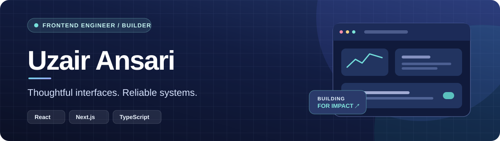

  

  <strong>Frontend Engineer · React, Next.js & TypeScript</strong> 
  Enterprise workflows, real-time applications, and AI-powered interfaces

  <a href="https://uzairansari11.vercel.app/"><strong>View portfolio</strong></a> ·
  <a href="#featured-repositories"><strong>Explore the code</strong></a> ·
  <a href="https://www.linkedin.com/in/uzairansari11/"><strong>Connect on LinkedIn</strong></a> ·
  <a href="mailto:uzairans532@gmail.com"><strong>Email me</strong></a>

I’m Uzair, a software engineer based in Mumbai. I’ve built **4 production applications from scratch**, shipped a browser calling platform used by **1,500+ users**, and mentored **3 junior developers**. My current enterprise work includes conversational interfaces, API integrations, and onboarding workflows.

## Featured repositories

| Project | What to look at |
| :--- | :--- |
| **[Clothify](https://github.com/uzairansari11/Clothify)** | React and Redux storefront with checkout, order management, and a role-based admin dashboard. The Express and MongoDB API shows how the frontend connects to the backend. |
| **[Product Catalog](https://github.com/uzairansari11/simfoni_assignment)** | A focused React and TypeScript example with search, filtering, sorting, and responsive product pages. |
| **[ChatApp](https://github.com/uzairansari11/ChatApp)** | Real-time messaging with React and Socket.IO, backed by Express and MongoDB. |

## Production work

- **ERP-style CRM.** Architected the frontend for 10+ modules spanning quotations, inventory, and procurement. Quotation automation cut creation time by **97%** and errors by **90%**.
- **AI finance platform.** Built the UI for financial analysis, forecasting, and OCR invoice processing. The platform reduced analyst effort by **70%** and sped up invoice verification by **80%**. Migrated the UI from HeroUI to shadcn/ui while preserving existing business logic and API integrations.
- **Browser-based VoIP platform.** Built React and SIP.js calling interfaces for **1,500+ users**. Real-time dashboards and call controls reduced handling time by **35%**. Isolated audio by call session to fix overlapping playback.
- **Project management and time tracking.** Led frontend development for an internal tool that replaced a paid SaaS product. A shared component library made feature delivery **40% faster**.

## Currently building

**DocuMind** is a PDF assistant that retrieves and reranks relevant passages, then streams answers with source citations. It also uses background jobs to turn PDFs into podcasts. The stack includes React, Node.js, PostgreSQL, Qdrant, Redis, BullMQ, and OpenAI APIs.

## Toolkit

- **Frontend** · React, Next.js, TypeScript, Redux Toolkit, TanStack Query, React Hook Form, Tailwind CSS, shadcn/ui
- **Backend and data** · Node.js, Express, REST APIs, PostgreSQL, Prisma, Redis, BullMQ
- **Real-time and AI** · SIP.js, Socket.IO, server-sent events, document retrieval and reranking
